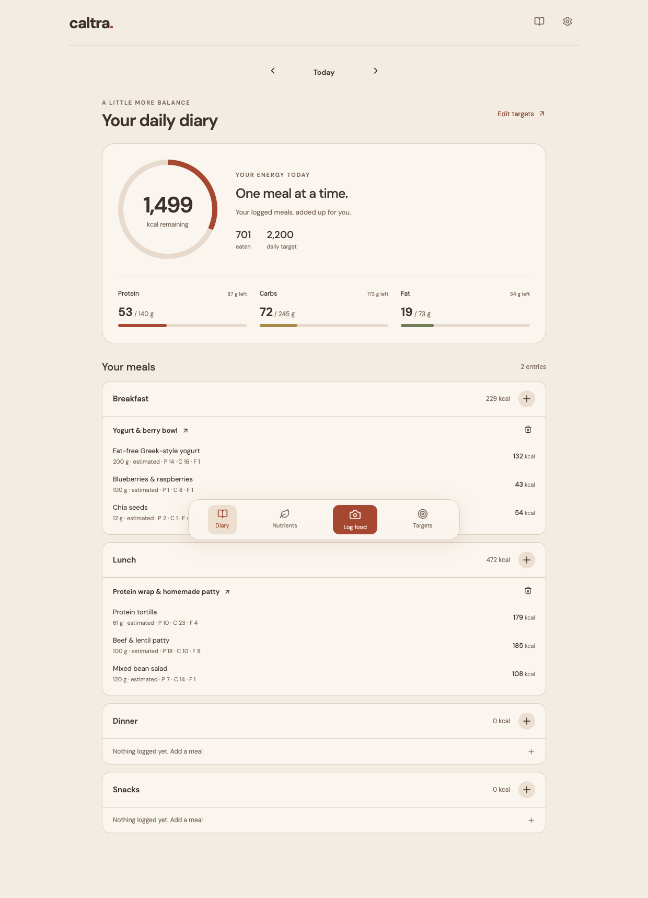

# Caltra

**Photo-first nutrition tracking, with a focus on UK foods.**

Caltra is an early-stage nutrition tracker: photograph a meal, add what the camera cannot see, review the estimated foods and portions, and log them to your daily diary. It combines Gemini image analysis with UK food records, saved product labels and deterministic nutrient calculations.

This repository runs locally. A hosted service and native mobile app are not available yet.

## What it does

- **Photo + context:** upload a photo and optionally describe hidden ingredients. Caltra inventories the pictured meal automatically, including possible shared foods with estimated amounts. A side photo and product-default controls are optional. Review, halve or remove foods afterward; different foods on the same plate remain separate entries when identified.
- **Manual food logging:** search UK foods or products without a photo, select a supplied serving or enter grams/ml, preview macros and add multiple foods to a meal.
- **Editable food breakdown:** review each food, portion, source and macro estimate; halve one food or the whole meal, answer optional follow-up questions and undo AI corrections.
- **UK food lookup:** UK CoFID generic foods and UK-market Open Food Facts product records, with barcode lookup and manual label entry.
- **Your usual products:** save specific products for compatible ingredients in homemade meals.
- **Daily diary:** calories, protein, carbohydrate and fat remaining against your saved targets; foods grouped by breakfast, lunch, dinner and snacks for a selected date.
- **Nutrient details:** fibre, vitamins and minerals where source data is available. Missing values are unknown; partial totals are marked.
- **Target setup:** a local starting-target calculator, optional Gemini explanation, and editable targets that require your review before saving.
- **Remembered meals:** reuse a saved meal without another image-analysis request.

## Screenshots

Screenshots use fictional demonstration entries, not a personal food diary.



## Getting started

Use Python 3.12 and Node.js 20+ with pnpm.

```sh
python3.12 -m venv .venv
.venv/bin/python -m pip install -r requirements-app.txt
pnpm install --frozen-lockfile
pnpm build
.venv/bin/python -m uvicorn backend.main:app --host 127.0.0.1 --port 8000
```

Open [localhost:8000](http://127.0.0.1:8000). On macOS, `start.command` can launch the app after setup.

1. Open **Targets** and calculate or enter your daily targets.
2. To enable photo analysis, connect your own Gemini key in **Settings**. Alternatively copy `.env.example` to `.env` and set the key there.
3. Add your usual UK products in **Settings → My usual products**.
4. Choose **Log food**, select a meal/date, then either take a photo or choose **Search foods**. Review portions and save the meal to your diary.

Basic diary, source search and nutrient arithmetic can work without Gemini. Photo recognition and AI help require an accessible configured model. The sample model name reflects the development configuration; replace it if your Google project does not support it. Google API quotas and pricing apply separately. Caltra does not enable billing for you.

The complete legacy development environment in `requirements.txt` includes optional ML experiment dependencies. They are unnecessary for the current app; use `requirements-app.txt` for the smaller installation.

## How estimates work

```text
Photo + your description
        ↓
Gemini identifies foods and proposes rough portions
        ↓
UK food/product records are retrieved and matched
        ↓
Source nutrients × reviewed amount → meal and daily totals
```

The source-selection stage chooses existing records; it cannot edit their nutrient values. When no suitable record is found, a separate Gemini call can propose clearly labelled, unverified nutrition estimates. Food corrections trigger matching and recalculation. A photograph cannot reliably reveal ingredient amounts, added oil or hidden components, so the review step matters.

There is no demonstrated 90% accuracy guarantee or validated accuracy advantage over commercial trackers. The current weak point is portion estimation. Repeatable output and passing software tests do not establish nutritional accuracy.

## Tests

```sh
.venv/bin/python -m pip install -r requirements-dev.txt
GEMINI_API_KEY='' .venv/bin/python -m pytest -q
pnpm build
```

With the app running, the current browser flows can be checked with:

```sh
node tests/manual-search-browser.cjs
node tests/daily-diary-browser.cjs
node tests/plated-pieces-browser.cjs
```

These browser scripts currently expect Google Chrome at its standard macOS installation path. They mock analysis/diary requests where specified and do not upload private photos. Older browser scripts reflect earlier UI versions. Historical parser tests explicitly use bundled legacy USDA fixtures; production nutrition lookup remains UK-only.

## Privacy and deployment

- Meals, remembered meals, usual products and successful structured analysis results are stored in the local SQLite database. Successful photo analyses are cached using a fingerprint; original image bytes are not stored in that cache.
- Uploaded images and requested AI context are sent to Google. UK branded-food searches send search terms to Open Food Facts. Check provider terms before submitting sensitive content.
- Keys are stored in a local `.env` file or an existing private `~/.config/caltra/.env`; neither belongs in Git. Food images, databases, evaluation outputs and downloaded weights are excluded from this repository.
- The server is restricted to localhost. This prototype has no public-service account isolation, authentication or multi-user deployment setup. Do not expose it as a shared hosted service without adding those controls.

## Technology

React 19 · TypeScript · Vite · FastAPI · Pydantic · SQLite · Gemini API

Portion-estimation research code is retained under `experiments/`; its downloaded datasets, weights and results are excluded. Those experiments are not a trained production model used by the current photo flow.

## Data and attribution

- **UK CoFID 2021**, Public Health England, [official dataset and user guide](https://www.gov.uk/government/publications/composition-of-foods-integrated-dataset-cofid), contains public sector information licensed under the [Open Government Licence v3.0](https://www.nationalarchives.gov.uk/doc/open-government-licence/version/3/). The bundled normalized data includes macro and available micronutrient values. `scripts/import_cofid.py` imports the official workbook.
- **Open Food Facts**, [database and licensing](https://world.openfoodfacts.org/terms-of-use): UK-market community product records queried at runtime, subject to ODbL and applicable content/image licences. Product completeness and correctness vary. No Open Food Facts product-image collection is bundled.
- **USDA FoodData Central**, [dataset downloads](https://fdc.nal.usda.gov/download-datasets/): legacy public-domain parser/test fixtures only, excluded from production UK lookup.
- **Mifflin–St Jeor**, [original equation paper](https://pubmed.ncbi.nlm.nih.gov/2305711/): starting estimate of resting energy for the target calculator. Activity and macro-split defaults remain editable estimates.

Third-party data and dependencies retain their own terms. No blanket open-source licence has been selected for Caltra's application code yet.

## Dietary patterns and data coverage

The Nutrients tab includes 3-day and 7-day reviews ending on the selected diary date. Optionally mark days as finished logging. A recurring low-intake flag needs at least three complete days with full data coverage for that nutrient; missing dates and missing nutrient values never count as zero. Initial food suggestions use general adult NHS references for fibre, calcium and vitamin C. Other nutrients show recorded averages where available, without personalised deficiency claims. This is an in-app review, not a background notification service or clinical assessment.

Foods with macro-only AI estimates remain unknown for vitamins and minerals. Exact plain UK ingredient aliases can use CoFID references when source selection finds no match; product labels and composite recipes are not silently replaced with generic ingredients. Historical meal snapshots are preserved.

Photo analysis makes no automatic retry. Incomplete provider replies, timeouts and service failures have separate messages; descriptive metadata is bounded without relaxing nutrition or quantity validation. Corrections that change an AI-estimated food's identity or preparation no longer reuse its old calorie density. Portion accuracy remains limited by image evidence.
